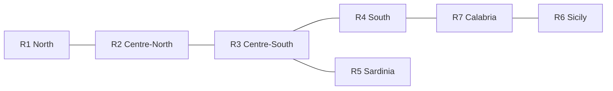
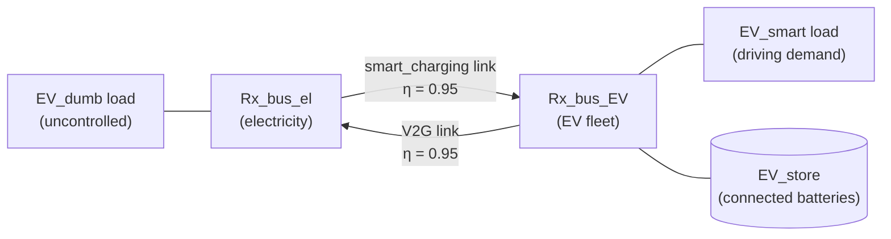

# PyPSA-Italy: smart charging and vehicle-to-grid in Italy's power system

[](LICENSE)
[](data/LICENSE)
[](https://pypsa.org)
[](https://doi.org/10.1016/j.seta.2026.105474)
[](https://www.python.org)

PyPSA-Italy is a seven-zone, hourly capacity-expansion model of the Italian
electricity system for 2025–2050. It was built to study how electric vehicles
that charge smartly or feed power back to the grid (vehicle-to-grid, V2G)
change the cost and design of a power system that reaches zero CO2 emissions
by 2050.

This repository has the model code and input data used in:

> P. D. Kumar *et al.*, "Role of Smart Charging and Vehicle-to-Grid for
> Long-Term Decarbonization Pathways in Italy", *Sustainable Energy
> Technologies and Assessments* (2026), article 105474.
> [doi:10.1016/j.seta.2026.105474](https://doi.org/10.1016/j.seta.2026.105474)

> [!NOTE]
> The model is written directly on the [PyPSA](https://github.com/PyPSA/PyPSA)
> framework. It is **not** based on PyPSA-Eur or PyPSA-Earth: there is no
> Snakemake workflow and no automatic network or renewable-profile building.
> Each planning year is a complete PyPSA network stored in a single Excel
> workbook, which a short script solves.

---

## Contents

- [Model overview](#model-overview)
- [Scenarios](#scenarios)
- [Repository structure](#repository-structure)
- [Installation](#installation)
- [Running the model](#running-the-model)
- [Outputs](#outputs)
- [Input data](#input-data)
- [Reproducing the paper](#reproducing-the-paper)
- [Citation](#citation)
- [License](#license)
- [Acknowledgements and contact](#acknowledgements-and-contact)

## Model overview

| | |
|---|---|
| Framework | PyPSA (linear optimal power flow / capacity expansion) |
| Spatial resolution | 7 nodes, one per Italian bidding zone (R1–R7) |
| Temporal resolution | 8760 hourly snapshots per year |
| Planning years | 2025, 2030, 2035, 2040, 2045, 2050 |
| Pathway | Myopic: each year is optimised in turn, and capacity built in one year is kept as the minimum for the next |
| Objective | Minimise total annualised system cost (investment plus operation) |
| Climate target | CO2 cap falling linearly from 67.1 Mt (2025) to 0 (2050) |
| Solver | Gurobi (HiGHS also works) |

**Zones.** R1 North, R2 Centre-North, R3 Centre-South, R4 South,
R5 Sardinia, R6 Sicily, R7 Calabria. Zones exchange power through
transmission links with existing transfer capacities that the optimiser may
expand.



**Technologies.** In every zone the model can invest in onshore wind,
rooftop PV, utility-scale PV, agrivoltaics, stationary batteries,
electrolysers, hydrogen storage, fuel cells and transmission. The existing
fleet of gas (CCGT), hydro (reservoir and run-of-river), pumped hydro,
geothermal and biomass plants, plus imports at the northern border, is fixed.
A very expensive "shortage" generator in each zone shows any unserved demand.

**Electric vehicles.** EV charging demand is split into an uncontrolled
("dumb") part and a flexible part. In the input data, 30% of EV energy
demand is flexible.



- *Uncontrolled charging* is a fixed hourly load on the electricity bus.
- *Flexible EVs* have their own bus. Their driving demand is a load on that
  bus, and the connected battery capacity is a store. Power reaches the
  fleet through the `smart_charging` link and, in the V2G case, can flow back
  through the `V2G` link.
- Both links are limited hour by hour by the share of vehicles plugged in
  (`links-p_max_pu`), from emobpy mobility profiles built on Lombardy
  origin–destination data.

The full description of the model, assumptions and data sources is in the
paper.

## Scenarios

The three charging strategies of the paper are all solved from the V2G-30%
input workbooks in `data/V2G_30/`. `ev_mode` in `config/config.yaml` decides
how the EV fleet is modelled:

| Scenario | `ev_mode` | EV representation |
|---|---|---|
| `Dumb` | `dumb` | **100% of EV demand is uncontrolled charging.** No smart charging and no V2G: the flexible 30% from the workbook is added to the uncontrolled EV load of the same zone (same hourly profile), and the EV store, smart-charging and V2G components are removed. Total EV demand is the same as in the other cases. |
| `SC_30` | `smart` | 70% of EV demand is uncontrolled; 30% is charged smartly. The `V2G` links are removed. |
| `V2G_30` | `v2g` | 70% of EV demand is uncontrolled; 30% is charged smartly and can feed power back to the grid through the `V2G` links. |

## Repository structure

```
PyPSA-Italy/
├── config/
│   └── config.yaml                 scenarios, years, solver and plot settings
├── data/
│   ├── README.md                   description of the input workbooks
│   ├── LICENSE                     CC BY 4.0 for the data
│   └── V2G_30/
│       └── input_<year>.xlsx       V2G-30% input network, one per planning year
├── scripts/
│   ├── _helpers.py                 paths, colours, shared functions
│   ├── solve_network.py            build and solve all years of one or more scenarios
│   ├── compare_scenarios.py        cost, emissions and capacities across scenarios
│   ├── plot_generation_mix.py      annual electricity production by source
│   ├── plot_generation_per_bus.py  annual production and demand per zone
│   ├── plot_dispatch.py            winter and summer week dispatch, all years
│   ├── plot_capacity_per_bus.py    optimal capacities per zone
│   ├── plot_bus_dispatch.py        hourly balance of a single zone
│   └── plot_grid_load_profile.py   average daily grid-load shape, workday vs weekend
├── results/                        created when you run the model (not tracked)
├── environment.yml
├── requirements.txt
├── CITATION.cff
└── LICENSE                         MIT for the code
```

## Installation

Clone the repository and create the environment with conda (or mamba):

```bash
git clone https://github.com/pranavdeep1992/PyPSA-Italy.git
cd PyPSA-Italy
conda env create -f environment.yml
conda activate pypsa-italy
```

or with pip in an existing Python 3.10+ environment:

```bash
pip install -r requirements.txt
```

The code has been tested with PyPSA 0.35 (pandas 2) and PyPSA 1.4
(pandas 3).

**Solver.** The paper results were computed with
[Gurobi](https://www.gurobi.com) 11, which needs a licence (free for academic
use). `gurobipy` is installed by the environment file; you still need to
activate a licence. Without Gurobi, set `solver: name: highs` in
`config/config.yaml`. HiGHS is open source and reaches the same optimal
cost, but a full year takes much longer. For large runs with HiGHS we
suggest:

```yaml
solver:
  name: highs
  options: {solver: ipm, run_crossover: "off"}
```

A single year needs roughly 6–8 GB of RAM.

## Running the model

All commands are run from the repository root. The scripts locate their files
relative to the repository, so they also work from an IDE such as VS Code.
Every script accepts `--scenario <name>`; without it, the `scenario` set in
`config/config.yaml` is used.

**1. Solve**

```bash
python scripts/solve_network.py --scenario Dumb SC_30 V2G_30
```

Years are solved in order 2025 → 2050. More options:

```bash
python scripts/solve_network.py --scenario V2G_30 --years 2040 2045 2050   # resume a pathway
python scripts/solve_network.py --solver highs                              # override the solver
python scripts/solve_network.py --config my_config.yaml                     # another config file
```

When a myopic run starts part-way, the script reads the capacities of the
previous year from `results/` if that year has already been solved.

**2. Compare the scenarios**

```bash
python scripts/compare_scenarios.py                  # relative to Dumb
python scripts/compare_scenarios.py --reference SC_30
```

**3. Make the figures** (repeat with `--scenario` for each case)

```bash
python scripts/plot_generation_mix.py --scenario V2G_30
python scripts/plot_generation_per_bus.py --scenario V2G_30
python scripts/plot_dispatch.py --scenario V2G_30
python scripts/plot_capacity_per_bus.py --scenario V2G_30
python scripts/plot_bus_dispatch.py --scenario V2G_30 --all-zones --year 2040
python scripts/plot_grid_load_profile.py --scenario Dumb SC_30 V2G_30 --zone R1 --year 2040
```

`--dispatched` (in `plot_dispatch.py` and `plot_generation_per_bus.py`) shows
renewables at actual output instead of available output. Each script's
`--help` lists all options.

### Configuration

`config/config.yaml` controls:

| Key | Meaning |
|---|---|
| `scenario` | scenario used when no `--scenario` flag is given |
| `scenarios` | for each scenario: input folder under `data/`, `ev_mode`, y-axis limit of the generation-mix figure |
| `years` | planning years to solve |
| `myopic` | carry optimal capacities forward from year to year (`true` in the paper) |
| `solver` | solver name and options passed to it |
| `extendable` | carriers whose capacity the optimiser may expand |
| `export.full_excel` | also save each solved network as one Excel workbook |
| `plotting` | figure resolution and the winter/summer weeks shown |

## Outputs

Results of each scenario go to `results/<scenario>/`:

| Path | Content |
|---|---|
| `input_csv/<year>/` | the workbook converted to PyPSA CSV tables, before the scenario's `ev_mode` is applied |
| `networks/<year>/` | the solved network in PyPSA CSV format, reload with `pypsa.Network().import_from_csv_folder(...)` |
| `summary/summary_<year>.xlsx` | system cost, CO2 emissions, capacities by component and carrier, energy and hourly dispatch by generator |
| `summary/network_<year>.xlsx` | the full solved network in one workbook (if `export.full_excel`) |
| `summary/*.csv` | the tables behind the figures |
| `plots/` | all figures |

Cross-scenario outputs (`scenario_comparison.csv` and multi-scenario
load-profile figures) go to `results/comparison/`.

Two cost measures are reported. The *objective* is what the optimiser
minimises. The *total cost* is PyPSA's annualised capex plus opex of every
asset, existing fleet included, so it is much larger, but the differences
between scenarios are the same.

## Input data

`data/V2G_30/input_<year>.xlsx` holds the V2G-30% input network, one per year.
The SC-30% and Dumb scenarios are derived from these same files at run time.
Sheet names follow PyPSA's CSV layout (`buses`, `generators`, `links`,
`loads-p_set`, `generators-p_max_pu`, ...). The first three sheets (`Notes`,
`Techn + Costs`, `Components`) document how the values were derived and are
not read by the model.

See [`data/README.md`](data/README.md) for sheets, units, naming and how to
build a new scenario.

## Reproducing the paper

The settings in `config/config.yaml` are those used in the paper (myopic
pathway, Gurobi, 2025–2050). Run the solve and compare steps above for the
three scenarios.

Expect small differences in later years when you re-run with another solver
or solver version. Many solutions have almost the same cost (for example,
transmission or storage built in one zone rather than the next). In a
myopic chain, which of these the solver picks in one year sets the minimum
capacities for the next. System costs, emissions and capacity totals stay
stable.

## Citation

If you use this model or data, please cite the paper:

```bibtex
@article{Kumar2026_PyPSAItaly_V2G,
  title   = {Role of Smart Charging and Vehicle-to-Grid for Long-Term Decarbonization Pathways in Italy},
  author  = {Kumar, Pranav Deep and others},
  journal = {Sustainable Energy Technologies and Assessments},
  year    = {2026},
  pages   = {105474},
  doi     = {10.1016/j.seta.2026.105474}
}
```

GitHub also reads [`CITATION.cff`](CITATION.cff) and shows a "Cite this
repository" button.

## License

- Code (everything in `scripts/` and `config/`): [MIT](LICENSE)
- Data (everything in `data/`): [CC BY 4.0](data/LICENSE)

## Acknowledgements and contact

Developed at the Department of Energy, Politecnico di Milano, and the
Institute for Renewable Energy, EURAC Research (Bolzano), as part of a joint
PhD programme.

Built with [PyPSA](https://pypsa.org) ([Brown, Hörsch & Schlachtberger, 2018](https://doi.org/10.5334/jors.188)).
EV availability profiles were generated with
[emobpy](https://gitlab.com/diw-evu/emobpy/emobpy).

Questions and bug reports: please open an
[issue](https://github.com/pranavdeep1992/PyPSA-Italy/issues) or contact
Pranav Deep Kumar ([ORCID 0009-0005-0660-6307](https://orcid.org/0009-0005-0660-6307)).
